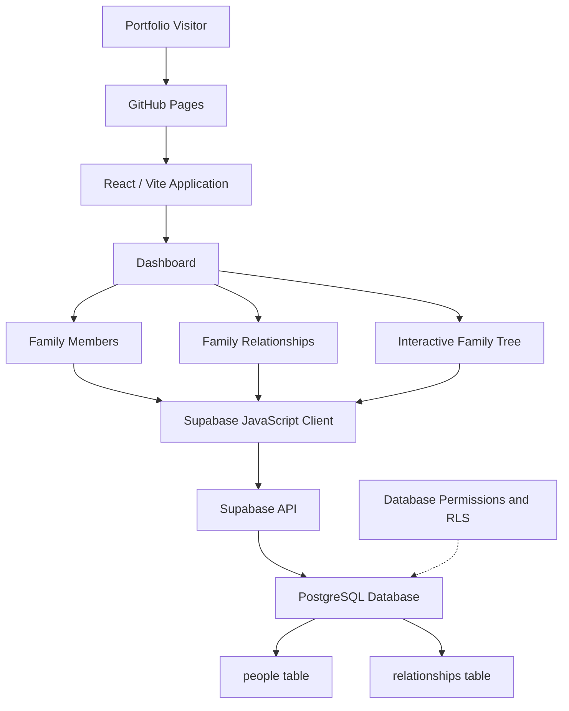

# System Architecture & Technical Design

## Family Heritage Tree — Interactive Genealogy Application

**Developer:** Angelica Reyes  
**Project Type:** Full-Stack Web Application Demonstration  
**Architecture:** React Single-Page Application with Supabase Backend  
**Deployment:** GitHub Pages and GitHub Actions  
**Status:** Public Read-Only Demonstration

---

## 1. Architecture Overview

Family Heritage Tree is a web application designed to display and visualize genealogical information through a structured, interactive interface.

The public demonstration uses fictional Bennett family records to showcase family member profiles, relationships, and an interactive family tree.

The application follows a client-server architecture consisting of:

- **Presentation Layer:** React components and CSS for the user interface.
- **Application Layer:** JavaScript logic for navigation, data processing, and visualization.
- **Data Access Layer:** Supabase JavaScript client for communicating with the backend.
- **Database Layer:** Supabase PostgreSQL for storing family members and relationships.
- **Deployment Layer:** GitHub Actions and GitHub Pages for building and hosting the application.

The public demonstration operates without requiring users to create accounts or sign in.

## 2. High-Level System Architecture

### Architecture Explanation

Visitors access the application through GitHub Pages, which serves the compiled React application.

The dashboard provides navigation to three primary features. Each feature retrieves the information it needs through the Supabase JavaScript client.

Supabase processes the database requests according to the configured permissions and Row Level Security policies.

The retrieved data is transformed into React interface elements, including an interactive family tree built with React Flow.

## 3. Technology Stack

| Technology | Architectural Responsibility |
|---|---|
| React | Component-based user