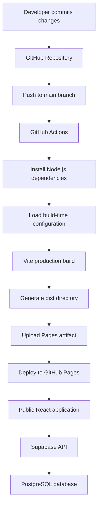

# Deployment & CI/CD Documentation

## Family Heritage Tree — Interactive Genealogy Application

**Developer:** Angelica Reyes  
**Application:** Family Heritage Tree Demo  
**Frontend:** React, JavaScript, Vite  
**Database:** Supabase PostgreSQL  
**Source Control:** Git and GitHub  
**CI/CD:** GitHub Actions  
**Hosting:** GitHub Pages  
**Deployment Branch:** `main`  
**Last Updated:** November 2026

---

## 1. Deployment Overview

The Family Heritage Tree Demo is deployed as a static React single-page application using GitHub Pages.

GitHub Actions automates the production build and deployment process whenever changes are pushed to the `main` branch.

The application connects directly to Supabase through its JavaScript client to retrieve fictional family member and relationship records.

The deployment architecture separates the frontend hosting environment from the database service.

### Production URLs

**Live Application:**  
https://reyesangelica-fs.github.io/family-heritage-tree-demo/

**GitHub Repository:**  
https://github.com/ReyesAngelica-FS/family-heritage-tree-demo

## 2. Deployment Architecture



GitHub Pages hosts the generated HTML, CSS, JavaScript, and other static assets.

Supabase provides the separate backend API and database infrastructure.

## 3. Deployment Prerequisites

The deployment requires:

- A GitHub repository containing the application source code.
- A working React/Vite application.
- A `package.json` file with build scripts.
- A dependency lockfile for reproducible installation.
- A configured Supabase project.
- A Supabase publishable key.
- GitHub Actions enabled for the repository.
- GitHub Pages configured to use GitHub Actions.

### Required Build Command

```bash
npm run build
```

This command generates production-ready assets in the `dist` directory.

## 4. Vite Configuration

GitHub Pages hosts this application under a repository-specific path:

`/family-heritage-tree-demo/`

Vite must generate asset URLs that account for this path.

### Example `vite.config.js`

```javascript
import { defineConfig } from "vite";
import react from "@vitejs/plugin-react";

export default defineConfig({
  plugins: [react()],
  base: "/family-heritage-tree-demo/",
});
```

The `base` property ensures that JavaScript, CSS, and other bundled assets load from the correct location.

Without the appropriate base path, the deployed application may fail to load its assets.

## 5. Supabase Environment Configuration

The application uses environment variables to configure its connection to Supabase.

### Local Development

Create a `.env.local` file in the project root.

```env
VITE_SUPABASE_URL=your_supabase_project_url
VITE_SUPABASE_PUBLISHABLE_KEY=your_supabase_publishable_key
```

The values must correspond to the Supabase project containing the fictional demonstration records.

### Supabase Client

The application initializes the Supabase client using Vite environment variables.

Example:

```javascript
import { createClient } from "@supabase/supabase-js";

const supabaseUrl = import.meta.env.VITE_SUPABASE_URL;

const supabasePublishableKey =
  import.meta.env.VITE_SUPABASE_PUBLISHABLE_KEY;

if (!supabaseUrl || !supabasePublishableKey) {
  throw new Error("Missing Supabase demo configuration");
}

export const supabase = createClient(
  supabaseUrl,
  supabasePublishableKey
);
```

### Environment Variable Security

Variables beginning with `VITE_` are embedded into the compiled frontend and can be inspected by visitors.

Therefore:

- Use only the intended Supabase publishable key.
- Never use a Supabase secret or `service_role` key.
- Do not place privileged credentials in frontend environment variables.
- Enforce data access using PostgreSQL permissions and Supabase Row Level Security.
- Keep `.env.local` out of version control.

Although GitHub Actions secrets can be used to supply the build configuration, the resulting publishable values are still available in the browser application.

## 6. GitHub Repository Secrets

The deployment workflow obtains Supabase configuration from GitHub Actions repository secrets.

### Required Secrets

| Secret Name | Purpose |
|---|---|
| `VITE_SUPABASE_URL` | Supabase project URL |
| `VITE_SUPABASE_PUBLISHABLE_KEY` | Supabase public client key |

### Configuration Steps

1. Open the GitHub repository.
2. Select **Settings**.
3. Navigate to **Secrets and variables → Actions**.
4. Select **New repository secret**.
5. Enter the exact secret name.
6. Paste the corresponding value.
7. Save the secret.
8. Repeat for the second configuration value.

GitHub displays the saved secret names but does not reveal their values.

### Important

Adding or changing repository secrets does not automatically rebuild an existing deployment.

The GitHub Actions workflow must run again so Vite can incorporate the updated configuration.

## 7. GitHub Actions Deployment Workflow

**Workflow File:**

`.github/workflows/deploy.yml`

The following workflow represents the deployment configuration used for the public demonstration.

```yaml
name: Deploy Family Heritage Tree Demo

on:
  push:
    branches: [main]
  workflow_dispatch:

permissions:
  contents: read
  pages: write
  id-token: write

concurrency:
  group: pages
  cancel-in-progress: true

jobs:
  deploy:
    runs-on: ubuntu-latest

    environment:
      name: github-pages
      url: ${{ steps.deployment.outputs.page_url }}

    steps:
      - name: Checkout repository
        uses: actions/checkout@v4

      - name: Setup Node
        uses: actions/setup-node@v4
        with:
          node-version: 22
          cache: npm

      - name: Install dependencies
        run: npm ci

      - name: Build application
        run: npm run build
        env:
          VITE_SUPABASE_URL: ${{ secrets.VITE_SUPABASE_URL }}
          VITE_SUPABASE_PUBLISHABLE_KEY: ${{ secrets.VITE_SUPABASE_PUBLISHABLE_KEY }}

      - name: Configure GitHub Pages
        uses: actions/configure-pages@v5

      - name: Upload build
        uses: actions/upload-pages-artifact@v3
        with:
          path: dist

      - name: Deploy
        id: deployment
        uses: actions/deploy-pages@v4
```

### Workflow Explanation

| Step | Responsibility |
|---|---|
| Checkout repository | Downloads the source code |
| Setup Node | Installs the configured Node.js version |
| Install dependencies | Installs packages using the lockfile |
| Build application | Creates production assets with Supabase configuration |
| Configure GitHub Pages | Prepares Pages deployment |
| Upload build | Uploads the `dist` directory |
| Deploy | Publishes the application to GitHub Pages |

## 8. GitHub Pages Configuration

GitHub Pages must be configured to deploy using GitHub Actions.

### Setup Procedure

1. Open the repository on GitHub.
2. Navigate to **Settings → Pages**.
3. Locate **Build and deployment**.
4. Under **Source**, select **GitHub Actions**.
5. Save the configuration if prompted.

The workflow publishes the generated build files rather than serving the application's uncompiled source code.

## 9. Local Build Verification

Before deploying changes, verify that the application builds successfully.

### Install Dependencies

```bash
npm ci
```

### Start Development Server

```bash
npm run dev
```

### Build for Production

```bash
npm run build
```

### Preview Production Build

```bash
npm run preview
```

The production preview should load the application using the compiled assets.

Check that:

- The dashboard renders.
- Family members load.
- Family relationships display.
- The interactive family tree renders.
- No critical browser console errors appear.

## 10. Deployment Procedure

### Step 1 — Review Changes

```bash
git status
```

### Step 2 — Stage Files

```bash
git add .
```

Before committing, verify that no unintended local configuration files or sensitive information are staged.

### Step 3 — Commit Changes

```bash
git commit -m "Update Family Heritage Tree demo"
```

### Step 4 — Push to GitHub

```bash
git push origin main
```

### Step 5 — Monitor GitHub Actions

Open the repository's **Actions** tab.

Select the latest deployment workflow run and inspect the build and deployment steps.

### Step 6 — Verify Production

Open:

https://reyesangelica-fs.github.io/family-heritage-tree-demo/

Confirm that the application loads and can retrieve demonstration data.

## 11. Deployment Troubleshooting

Two deployment issues were encountered and resolved during development.

### Issue 1 — GitHub Pages Deployment Failure

**Symptom:** The initial GitHub Actions deployment did not complete successfully.

**Cause:** GitHub Pages had not been enabled or configured correctly.

**Resolution:** Updated the repository's GitHub Pages settings to use GitHub Actions.

**Outcome:** The deployment workflow subsequently completed successfully.

### Issue 2 — Blank Production Screen

**Symptom:** GitHub Actions reported a successful deployment, but the published application displayed a blank screen.

**Browser Console Error:**

```text
Uncaught Error: Missing Supabase demo configuration
```

**Cause:** The production build did not receive the required Supabase environment variables.

**Resolution:**

1. Created the required GitHub Actions repository secrets.
2. Corrected the workflow's environment variable references.
3. Ran the deployment workflow again.
4. Verified that the published application connected to Supabase.

**Outcome:** The application was reported as working after the configuration changes.

### Additional Troubleshooting Reference

| Symptom | Possible Cause | Recommended Action |
|---|---|---|
| Blank page | JavaScript runtime error | Inspect browser console |
| Assets return 404 | Incorrect Vite base path | Verify `vite.config.js` |
| Missing Supabase configuration | Missing build variables | Verify Actions secrets and rerun workflow |
| Database request denied | Database grants or RLS policy | Inspect Supabase access controls |
| `npm ci` fails | Dependency or lockfile issue | Review `package-lock.json` and workflow logs |
| Pages deployment fails | Incorrect Pages settings or permissions | Review repository settings and workflow permissions |
| Old content appears | Browser cache or old deployment | Confirm latest successful workflow and refresh |

## 12. Deployment Verification Checklist

The following checklist should be completed after major releases.

- [ ] Production build completes without errors.
- [ ] GitHub Actions workflow succeeds.
- [ ] GitHub Pages serves the latest build.
- [ ] Dashboard loads.
- [ ] Family member records display.
- [ ] Relationship records display.
- [ ] Interactive family tree renders.
- [ ] Browser console has no critical errors.
- [ ] Anonymous database permissions remain read-only.
- [ ] No privileged credentials are exposed.

## 13. Continuous Integration and Continuous Deployment

The project currently uses an automated build-and-deploy workflow.

A push to `main` triggers a production build and deployment.

This provides a repeatable release process and reduces the need to upload production files manually.

### Current CI/CD Capabilities

- Automatic workflow triggering on pushes to `main`.
- Dependency installation.
- Production compilation.
- GitHub Pages artifact creation.
- Automated deployment.

### Future CI/CD Improvements

Potential enhancements include:

- Automated unit tests using Vitest.
- Component tests using React Testing Library.
- End-to-end tests using Playwright.
- ESLint validation before deployment.
- Dependency vulnerability scanning.
- Pull request build validation.
- Deployment smoke tests.

These improvements are planned and are not currently documented as implemented.

## 14. Rollback and Recovery

If a deployment introduces a problem, the repository's Git history can be used to restore a previously working version.

### Recommended Recovery Procedure

1. Identify the last known working commit.
2. Review the changes introduced by the problematic deployment.
3. Revert the affected commit or restore the working code.
4. Push the corrective commit to `main`.
5. Allow GitHub Actions to deploy the corrected version.
6. Verify the public application.

For a committed change that needs to be reversed, the following command can be used:

```bash
git revert <commit-hash>
```

This creates a new commit reversing the selected change without rewriting shared Git history.

Database changes require separate recovery planning because reverting frontend code does not automatically reverse Supabase schema or data modifications.

## 15. Deployment Maintenance

Deployment maintenance includes:

- Reviewing GitHub Actions workflow results.
- Updating dependencies when appropriate.
- Checking compatibility with supported Node.js versions.
- Reviewing GitHub Actions versions.
- Verifying Supabase environment configuration.
- Monitoring browser console errors.
- Rechecking database access controls after security changes.

## 16. Conclusion

The Family Heritage Tree Demo uses an automated deployment pipeline that connects GitHub source control, Vite production builds, GitHub Actions, GitHub Pages, and Supabase.

The deployment process demonstrates practical experience in configuring CI/CD workflows, managing build-time environment variables, diagnosing production errors, and maintaining a publicly accessible web application.

Resolving the initial GitHub Pages configuration issue and missing Supabase environment variables provided valuable experience in debugging real deployment problems.

---

**Prepared by:** Angelica Reyes  
**Project:** Family Heritage Tree Demo  
**GitHub Repository:** https://github.com/ReyesAngelica-FS/family-heritage-tree-demo  
**Live Application:** https://reyesangelica-fs.github.io/family-heritage-tree-demo/